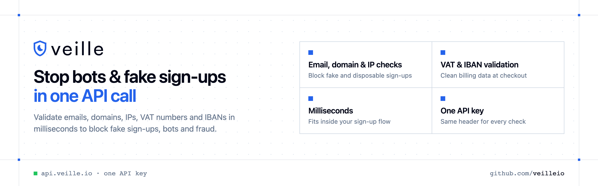

<p align="center">
  <a href="https://www.veille.io"></a>
</p>

<p align="center">

[](https://discord.gg/CFj3ph8aHU) [](https://www.veille.io) [](https://app.veille.io/register) [](https://app.veille.io/openapi)

</p>

**Veille** stops bots, fake sign-ups and automated attacks with one API call: validate **emails, domains and IP addresses** in milliseconds, and check **VAT numbers, IBANs and exchange rates** for billing.

### Why Veille?

- **Stop fake sign-ups** — validate emails and domains before creating accounts.
- **Block abuse** — check IP reputation to stop bots and automated attacks.
- **Clean billing data** — validate VAT numbers and IBANs, get exchange rates.
- **Fast** — designed to run inline in sign-up and checkout flows.
- **Copy-paste examples** — Python and TypeScript in each README, 7 more languages in `examples/`.

```bash
curl -G https://api.veille.io/v1/intelligence/email \
  -H "x-api-key: $VEILLE_API_KEY" \
  --data-urlencode "query=jane.doe@example.com"
```

### Repositories

- [**Domain Validation API**](https://github.com/veilleio/domain-validation-api) — Check domains for disposable, risky or invalid setups
- [**Email Qualification API**](https://github.com/veilleio/email-qualification-api) — Qualify an email: personal or professional, risk and company signals
- [**Email Validation API**](https://github.com/veilleio/email-validation-api) — Validate emails and block disposable or fake sign-ups
- [**Exchange Rates API**](https://github.com/veilleio/exchange-rates-api) — Currency exchange rates as JSON
- [**IBAN Validation API**](https://github.com/veilleio/iban-validation-api) — Validate IBANs before payments and payouts
- [**IP Reputation API**](https://github.com/veilleio/ip-reputation-api) — Detect risky IPs, proxies and bots before they act
- [**VAT Validation API**](https://github.com/veilleio/vat-validation-api) — Validate EU VAT numbers and company details

---

💬 [Discord](https://discord.gg/CFj3ph8aHU) · 📚 [API reference](https://app.veille.io/openapi) · 🔑 [Get your API key](https://app.veille.io/register) · 🌐 [www.veille.io](https://www.veille.io)
